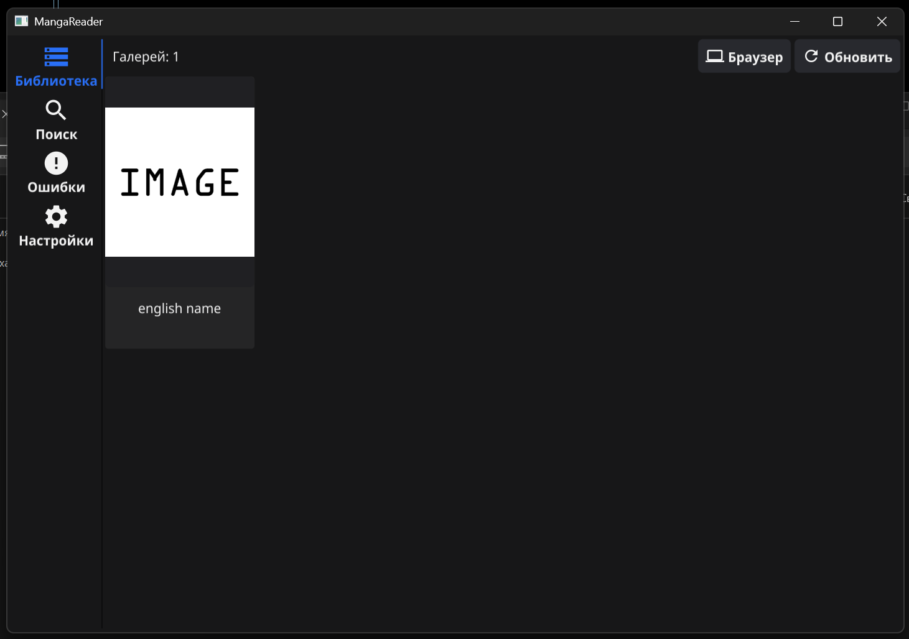
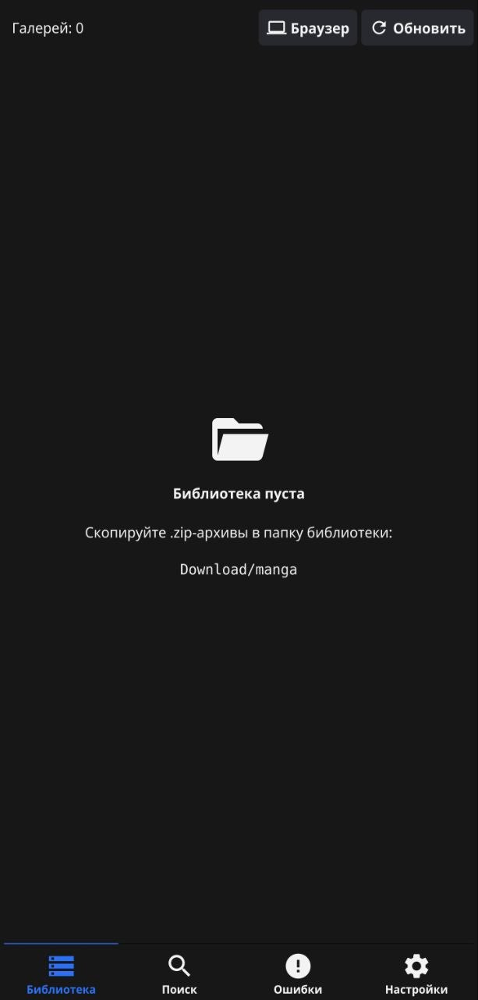
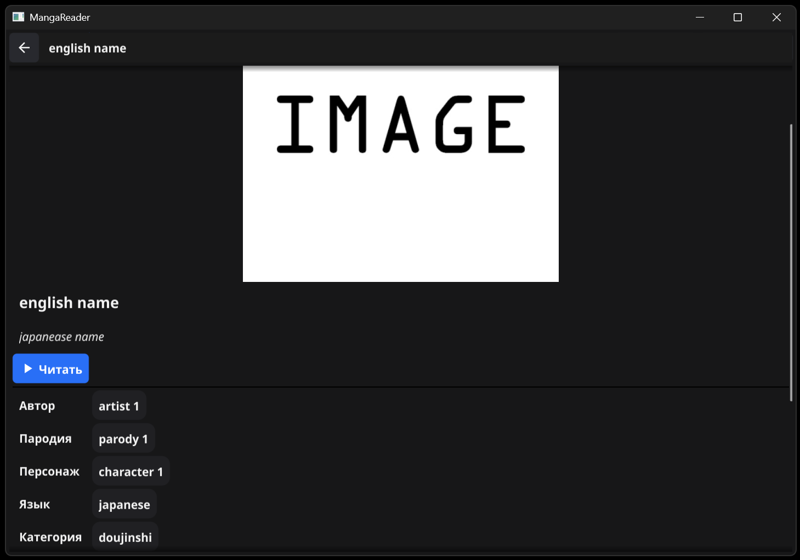
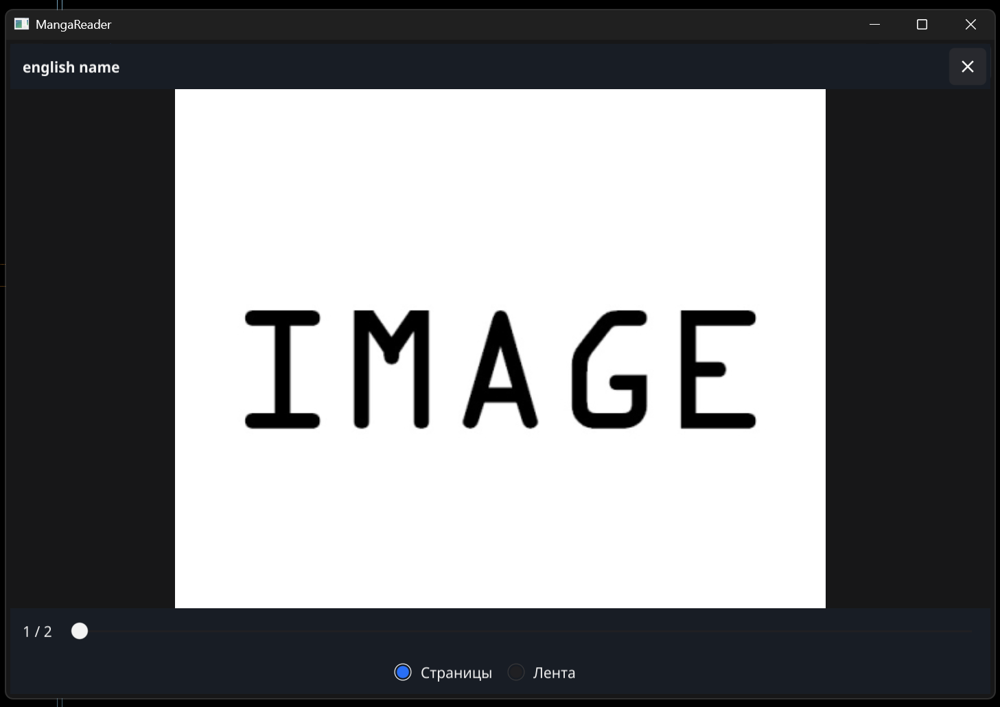
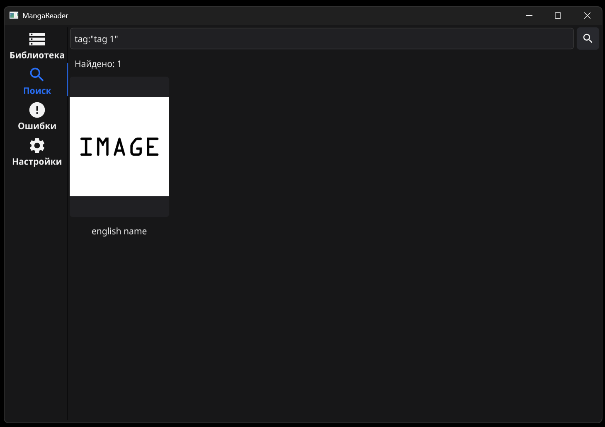
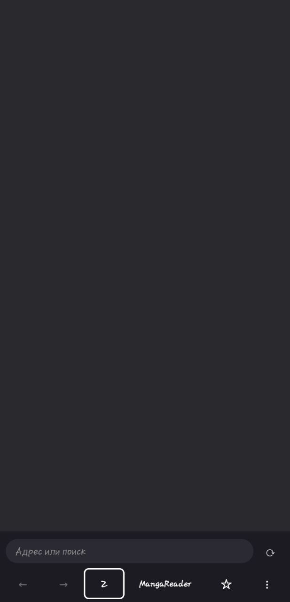

**English** | [Русский](../ru/user-guide.md)

# User guide

MangaReader shows manga from zip, RAR and 7z archives in your library folder and helps you grow it: the built-in browser saves downloads straight into that folder. Only the browser needs the internet — the library, reader and search work offline.

> The interface is available in English and Russian. By default it follows the system language (English if the app has no translation for it); you can pick the language in **Settings** → **Язык / Language**.

- [Library folder](#library-folder)
- [Archive format](#archive-format)
- [Where to get files](#where-to-get-files)
- [Library](#library)
- [Gallery page](#gallery-page)
- [Reader](#reader)
- [Search](#search)
- [Statistics](#statistics)
- [Built-in browser](#built-in-browser)
- [Errors](#errors)
- [Settings](#settings)

## Library folder

### Windows — portable mode

Everything is kept in the application folder and nowhere else (not in `%APPDATA%`, not in your user profile):

```text
MangaReader\
├── mangareader.exe
├── settings.json   ← settings, created after the first change
├── library.db      ← library catalog (created automatically, safe to delete)
├── user.db         ← your data about works (don't delete)
├── manga\          ← put your archives here (.zip, .cbz, .rar, .7z) (created on first start)
└── browser\
    ├── firefox\    ← built-in browser
    └── profile\    ← browser profile: bookmarks, cookies, extensions
```

- You can move the whole application folder, for example to a USB stick. Move it while the app is closed.
- `library.db` is the library catalog: parsed archives, errors, covers, search data and a copy of the page links of downloaded files. With it the app shows the library right away at startup and opens only new and changed archives. It is a cache: if you delete it, it is created again and the library is scanned from scratch. On Android the catalog lives in the app's private folder.
- `user.db` is your own data about works that can't be restored from the archives. Unlike the catalog, don't delete it: keep it when updating or moving the app. Records follow an archive when it is renamed or moved to another subfolder of `manga` (the app recognizes the archive by its pages). If the file gets damaged, the app renames it to `user.db.broken-<date-time>`, creates a new one and tells you at startup; the damaged copy stays next to it. On Android `user.db` lives in the app's private folder.
- Don't put it where you can't write (for example, `Program Files`): the app will show an error with the path.
- Archives may be arranged in subfolders inside `manga` — they are picked up too.

### Android — a folder you choose

On first start the system folder picker opens. Pick or create a folder **inside** `Download`, for example `Download/manga`, and tap "Use this folder" → "Allow". The app remembers the choice and sees everything in that folder and its subfolders: files saved by a browser, moved by a file manager or copied from a PC over USB. No special permissions ("all files access") are needed.

- Android doesn't allow picking the `Download` root itself. If a browser saved an archive directly into `Download`, move it into your folder.
- To change the folder: **Settings** → **Change folder**.
- If the folder was deleted or renamed, the app asks you to pick it again.
- Copying from a PC with adb: `adb push example.zip /sdcard/Download/manga/`.

### Automatic updates

While the app is open, the library updates itself: new, changed and removed files show up within a second or two, no need to press **Refresh**. Unfinished downloads (`*.part`) don't get in the way — the file is checked once the download completes. If a file is briefly locked by another program (an antivirus, for example), the app waits.

## Archive format

A gallery is a zip, RAR or 7z archive with images (`.jpg`, `.jpeg`, `.png`, `.gif`, `.webp`) and, optionally, a `meta.json` and/or `ComicInfo.xml` file. The extension doesn't matter: `.zip`, `.cbz`, `.rar`, `.cbr`, `.7z`, `.cb7` and any other name work, because the type is detected by content. PDF and EPUB are not supported.

RAR 5 (plain and solid) and 7z (plain and solid) are checked; RAR 4 should open but has not been tested. A **solid** RAR cannot be read page by page, so the first time you open a page the app unpacks the whole archive into a temporary cache (up to 512 MB, cleared when you close the app); an archive that does not fit is shown as an error. Archives protected with a password are not supported and land on the **Errors** tab.

```text
example.zip
└── example/
    ├── 1.jpg
    ├── 2.jpg
    └── meta.json
```

- Pages are ordered by name in natural order: `2.jpg` comes before `10.jpg`. Subfolders inside the archive are allowed.
- File names inside the archive may be in any encoding (for example, Shift-JIS from Japanese archivers), and folders may be separated by `/` or `\`. Service files (`__MACOSX`, names starting with `.`) are ignored; if several files have exactly the same name, the first one is used.
- The first page is the cover.
- Without `meta.json` and `ComicInfo.xml` the file name becomes the title, and there are no tags or details.

`meta.json` fields the app understands (everything else is ignored):

| Field | Meaning | Where it shows |
|---|---|---|
| `title.english` | Main title | Card, gallery page, reader |
| `title.japanese` | Alternative title (or the main one if there is no English title) | Gallery page |
| `id` | ID on the site (a number or a string with a number) | Search `id:` |
| `tags` | List of `{"type": "...", "name": "..."}`; types `artist`, `group`, `parody`, `character`, `language`, `category`, `tag`; other types are shown too | Gallery page, search |
| `upload_date` | Upload date on the site (Unix time) | "Uploaded", search `uploaded:` |
| `num_pages` | Page count according to the site | "Pages", if it differs from the archive |
| `num_favorites` | Number of favorites on the site | "Favorites", search `favorites:` |
| `scanlator` | Scanlator | "Scanlator", search `scanlator:` |
| `url`, `source`, `link`, `source_url`, `gallery_url` | Link to the work (the first `http(s)` one is used) | **Open in browser** button |

Example: [`testdata/example.zip`](../../testdata/example.zip).

### ComicInfo.xml

`ComicInfo.xml` (the standard comic-reader format, in UTF-8) is read from any depth of the archive; if there are several, the least nested one is used. It is a second source of details: **`meta.json` wins** — `ComicInfo.xml` only fills in what `meta.json` leaves empty (title, alternative title, link, date, page count) and adds tags that aren't there yet. A broken `ComicInfo.xml` is ignored with a warning. Fields:

| Field | Becomes |
|---|---|
| `Title` (otherwise `Series` plus `Number`) | Title |
| `AlternateSeries` | Alternative title |
| `Tags` (comma-separated) | `tag` tags |
| `Characters` | `character` tags |
| `LanguageISO` | `language` tag (`en` → `english`; an unknown code is kept as is) |
| `Format` | `category` tag |
| `Writer`, `Penciller` | `artist` tags |
| `Publisher` | `group` tag |
| `Year`, `Month`, `Day` | Upload date (a missing month or day is 1; no year — no date) |
| `PageCount` | Page count |
| `Web` | Link to the work, only if the address has a path (a bare site address is ignored) |

`Manga` (reading direction) and `AgeRating` are ignored. Example: [`testdata/cbz-example.cbz`](../../testdata/cbz-example.cbz).

## Where to get files

What the sites checked by hand give you (only what was verified is listed):

| Site | File you get |
|---|---|
| E-Hentai | zip |
| nhentai | zip, cbz |
| Desu.me | zip with `.webp` pages |
| DriveThruComics | pdf or zip (pdf is not supported) |
| GetComics | zip or cbz |
| MangaLib | shows a download, but no file is produced |

Other sites work online only or are unstable, so there is nothing to download from them.

## Library

The **Library** tab shows galleries as a grid of cards: cover and title. Card size is set in **Settings**, in the **Grid** section. Newest files come first (by file modification time). At the top are the gallery count and the **Refresh** button — usually not needed, since the folder is watched automatically.



Tapping a card opens its gallery page. The 🎲 button on the panel opens the page of a random gallery from the library; it is inactive while the library is empty. If the library is empty, the app shows the path of the folder to put archives into; you can copy the path in **Settings**.

**Kinetic scroll (phone).** A quick swipe along a list (the library, search, a gallery page, settings, the strip) goes on by itself after you lift your finger and slows down smoothly, the way it does in other Android apps; a faster swipe goes farther, and a series of swipes in one direction speeds it up. A touch stops the scrolling at once and does not count as a tap, so a card under your finger does not open; tap again to open it. At the end of a list the scroll just stops. Flipping pages in paged mode and moving a zoomed page have no inertia.



### Card menu

Every card in the library and in search results has a **⋮** button in the top-right corner of the cover. Right-clicking a card (PC) or pressing and holding it (phone) opens the same menu:

- **Open** — the gallery page;
- **Read** — the reader from page 1; closing it returns you to the grid;
- **Open in browser** — only when a link to the work is known; works like the button on the gallery page;
- **Copy title** — copies the main title to the clipboard;
- **Show in folder** (Windows only) — opens File Explorer in the archive's folder with the file selected;
- **Reset progress** — only if the work has been read: forget where you stopped (and the "finished" mark);
- **Delete…** — deletes the archive after confirmation (see below).

### Deleting an archive

**Delete…** always asks first and shows the title and the file's path inside the library folder:

- **Windows**: the file is moved to the **Recycle Bin** and can be restored from there. If the drive has no Recycle Bin (a USB stick, a network drive), the app says so and offers to delete the file permanently.
- **Android**: the file is deleted **permanently** — Android folders have no Recycle Bin, and the confirmation says so. Deleting needs write access to the library folder: if the folder was granted read-only, the app asks you to pick it again.

The card disappears from the library and the search results right away; then the library is rescanned. Your data about the work is kept for the period set in **Settings → Data retention**: if the file is restored (for example, from the Recycle Bin), the data comes back. If another program is using the file, the app says so and the file stays. A gallery that is open in the reader can't be deleted — close it first.

## Gallery page

Everything about one gallery:




- cover, title and alternative title;
- the **Read** button — from page 1, and **Continue · p. N** — from the page where you stopped (see [Reader](#reader));
- the **Open in browser** button — when a link to the work is known: from `meta.json`, or the page the file was downloaded from with the built-in browser;
- tags grouped by type: "Artist", "Group", "Parody", "Character", "Language", "Category", "Tags", then groups of other types. Your own tags come after the original ones in their group and have a yellow background. **Tapping a tag searches for it**;
- details: "Pages", "Uploaded", "Favorites", "Scanlator", "File", "Size", "Modified". Empty fields are hidden. Dates, numbers and sizes follow the interface language.

The **⋮** button on the right of the top bar holds the actions that are not on the page itself: **Copy title**, **Show in folder** (Windows), **Reset progress** (if the work has been read) and **Delete…**. After deleting, the page closes and you return to the grid.

### Editing tags

Tags from `meta.json` are set by the site. You can add your own tags of any type and hide the ones you don't need; the archive and `meta.json` are not changed. Press **Edit tags** under the details; **Done** leaves the edit mode (so does closing the page). Every change is saved right away. In the edit mode:

- **+** in a group adds a tag of that type. Type the name and press Enter or **Add**; Esc or **Cancel** closes the box. While you type, up to 10 suggestions show up below: names of this type from the library and your own tags, the most used first. Tap a suggestion to add it.
- **Add to another group** adds a tag of a type the work doesn't have yet (for example, "Group").
- **✕** on your own tag removes it. **✕** on an original tag hides it: in the edit mode it stays in place in red strikethrough text with **↺** to bring it back; outside the edit mode it is not shown, and a group with only hidden tags disappears.
- **Reset to original…** removes all your tags and shows all hidden ones again, after a confirmation.

Names are stored in lower case with single spaces, like the original tags. A name can't be empty, longer than 100 characters or contain `"`. If the work already has a tag of the same type and name (original, hidden or your own), the app says "This tag is already there" and changes nothing.

Your tags and hidden tags are kept in `user.db` (see [Windows — portable mode](#windows--portable-mode)). They survive restarts and follow the archive when it is renamed or moved inside the library folder. If `user.db` can't be opened, **Edit tags** is inactive and the tags from `meta.json` are shown as usual.

## Reader

**Read** opens the reader on top of all tabs. Close it with ✕ on the panel, Esc (PC) or Back (Android). Esc and Back close the reader first, then the gallery page.

**Where you stopped.** The reader remembers the page (in the strip — the one at the top of the screen), and the gallery page shows a **Continue · p. N** button. The position is saved only after you have turned at least one page: opening **Read**, looking at the cover and closing it keeps the previous position. When you finish (confirm "next" on the last page or press **Finish reading** in the strip), the work is marked finished and there is no **Continue** button — until pages are added to the archive after the last one you read: then **Continue** opens the first new page. The page is remembered by its file name in the archive, so pages removed or added in the middle do not shift the position; if that page is no longer in the archive, the reader opens the page with the same number and warns that the position may be inaccurate. The position is kept with your other data about the work and survives renaming the file without changing its contents.



Two modes, switched on the panel and remembered:

**Pages** — one page at a time. The default order is western (left to right); for manga you can choose **Right to left** in the settings (see [Settings](#settings)). The table is for left to right:

| Action | PC | Phone |
|---|---|---|
| Next page | →, ↓, PageDown, Space, wheel down, click the right third | Tap the right third, swipe right to left |
| Previous page | ←, ↑, PageUp, wheel up, click the left third | Tap the left third, swipe left to right |
| First / last | Home / End | Slider on the panel |
| Go to a page by number | G or click the page number on the panel | Tap the page number on the panel |
| Zoom in / out | Ctrl+wheel (towards the point under the cursor), Ctrl+= or Ctrl++ / Ctrl+− | Pinch with two fingers |
| Back to 100% | Ctrl+0, click the zoom indicator | Tap the zoom indicator |
| Zoom to the value from settings / back to 100% | Double click | Double tap |
| Move a zoomed page | Drag | Drag |
| Show / hide the panel | Click the middle third | Tap the middle third |

**Zoom** — from 100% (the page fits the screen) to 500%, the wheel and key step is ×1.25. An indicator such as "175 %" appears in the bottom right corner: it stays while the page is zoomed and fades out a second and a half after returning to 100%. A moment after the zoom changes, the page is reloaded at a higher resolution. Going to another page (including with the wheel without Ctrl) returns to 100%. The strip mode does not zoom.

With **Right to left** the left and right thirds, the swipe direction and the ← → keys are swapped; the wheel, ↓/↑, PageDown/PageUp and Space work as usual. The wheel also turns a zoomed page (the zoom is reset). A click or tap on an edge acts after a quarter of a second: that is how long the reader waits for a second tap to tell a double tap apart. With double tap turned off in the settings, taps act at once.

**End of the work.** "Next" on the last page shows a hint that the work has ended; "next" again closes the reader and returns to the gallery page. A quick series of wheel scrolls does not close the reader — a short pause is needed.

**Strip** — all pages one below another. Scroll with the wheel, ↓/↑, PageDown/PageUp, Space; → and ← jump to the next and previous page; Home/End go to the start and end. A single tap shows and hides the panel. After the last page there is a **The end** block with a **Finish reading** button; PageDown, ↓ or Space at the end of the strip work like "next" on the last page.

The panel: the title and the ✕ close button at the top; the **Home** button (⌂), page number "N / total", the slider and the **Pages** / **Strip** switch at the bottom.

- **Home** closes the reader and the gallery page: you return to the tab you came from (library, search).
- **Page number**: tap "N / total" to turn it into an input field (Android shows a numeric keyboard). Type a number and press Enter; a number below 1 opens the first page, above the page count — the last one. Esc, Back or a tap outside the field cancel the input.
- **Slider**: while you drag it, the chosen page is shown right away with its number above the thumb; the number on the panel changes when you release the slider. With **Right to left** the first page is at the right end.

Pages load in the background; the next two pages in the reading direction and one in the opposite direction are preloaded.

## Search

The **Search** tab searches the whole library. Conditions separated by spaces are combined with AND. Letter case, "ё"/"е" and character width don't matter: `елка` finds "Ёлка", `ＡＢＣ` finds "ABC". When the query runs depends on the mode chosen in **Settings**:

- **While typing** (the default) — half a second after you stop typing; results appear even while the keyboard is open. There is no 🔍 button, and Enter only closes the keyboard.
- **On button** — only when you press 🔍 or Enter.

The **✕** button clears the box and keeps the results on screen. The 🎲 button next to it opens the page of a random gallery from the current results; it is always visible but inactive until a query has found something. A query with a mistake keeps the previous results, so 🎲 keeps picking from them. The **How to search** cheat sheet is shown until the first query of the session; after that the screen always shows the last result, even with an empty box — the table below covers the same syntax.



| Query | Finds |
|---|---|
| `school` | Part of a word in the title, tags, scanlator, file name, ID |
| `"english name"` | The whole phrase |
| `tag:"tag 1"` | An exact tag of any type |
| `artist:"artist 1"` | A tag of a given type: `artist`, `group`, `parody`, `character`, `language`, `category` |
| `-tag:yuri` | Excludes works with the tag (also `-artist:…` etc.) |
| `custom-tag:"my fav"` | Your own tag of any type, see [Editing tags](#editing-tags) |
| `hidden-tag:yuri` | An original tag you hid |
| `missing:artist` | Works with no tag of a type (`artist`, `group`, `parody`, `character`, `language`, `category`, `tag`); also `missing:tags` (no tags at all) and `missing:meta` (no `meta.json` or `ComicInfo.xml` in the archive) |
| `pages:>20` | Page count: `>`, `<`, `>=`, `<=`, range `10..50` |
| `uploaded:2024` | Upload date on the site: `2024`, `>2024-06`, `2024-01..2024-03` |
| `added:>=2025-01` | When the file appeared in the folder (file modification time) |
| `size:>10mb` | File size: `k`, `mb`, `gb` |
| `favorites:>100`, `id:535147` | Favorites on the site and ID |
| `scanlator:name` | Scanlator |
| `school pages:>20 -tag:yuri` | All together |

Tags are searched as you see them on the gallery page: `tag:`, `artist:` and the other types find the original tags that aren't hidden plus your own ones, and a word in the query doesn't match hidden tags. `custom-tag:` finds only your own tags, `hidden-tag:` only hidden ones; both work with `-`. `missing:artist` takes the same current tags into account, and `-missing:artist` is the opposite (works that have an artist).

Dates: `2024` is the whole year, `2024-06` a month, `2024-06-15` a day; `>period` means after its end, `<period` before its start. If a query has a mistake, "Query error: …" appears below the search box with an explanation. Results refresh on their own when the library changes: the last query that ran is repeated.

## Statistics

The **Statistics** tab shows what the library consists of: which artists, parodies and languages prevail, how much space the works take, which ones have no metadata. It is the first tab on Windows and comes after **Search** on Android; the app still starts on **Library**. Statistics use the current tags of a work — the original ones except the hidden ones, plus your own — and the actual page count and file size.

Blocks, in this order (each one can be turned off, see below):

- **Summary** — works, pages and total size; average and median page count and size; the earliest and the latest upload date; the number of unique tags of each type. Sizes here and everywhere in the statistics have two decimal places (`1.27 GB`).
- **Artists, Groups, Parodies, Characters, Languages, Categories, Tags** — the first 5 rows of a top for each tag type with a bar, the value and the share. The switch in the block header ranks by works, pages or size, and the arrow next to it switches the order: descending or ascending. **Show all** opens the full list (up to 10 rows high, then it scrolls) with a **Find in list** box.
- **By page count** and **By file size** — works split into buckets (by default 20, 50, 100, 200, 500 pages; 5, 10, 20, 50, 100, 200 MB); under the size buckets come **Largest works**: by size or by page count (a switch), with the order arrow and **Show all** like the tops; tapping one opens its page.
- **By upload year** — one row per year of the upload date on the site, including years with no works, and **No date**.
- **Library growth** — works by the time the file was changed: by month while the history is shorter than 24 months, otherwise by year (the arrow next to a year shows its months).
- **Your tags** — how many works have your own and hidden tags, and a top of each.
- **Metadata quality** — works without `meta.json` and `ComicInfo.xml`, without an artist, without a language, without tags.

Tapping a tag, bucket, year, month or a quality row opens **Search** with the matching query (for example `size:>5mb size:<=10mb`, `missing:artist`) in front of which the statistics filter is put, so the found number matches the number in the row.

**Filter.** The box at the top takes the same syntax as search, including `-tag:…`; the numbers are recounted half a second after you stop typing or on Enter. **✕** clears it, and the filter is kept between launches.

**Hiding a tag.** Right-click (PC) or long press (phone: the menu opens while your finger is still on the screen) on a tag row opens a menu; the row stays highlighted while it is open. The tag disappears only from that block (and from the unique-tag count of its type in the summary); the works stay in all the other numbers, and the filter does not matter.

- **Hide** — until the app is restarted. Such tags are listed under the filter as `artist:x — Artists`: **✕** brings the tag back, **Permanently** makes the exclusion permanent. With more than three of them, a single **Excluded: N** row replaces the list; tap it to expand or collapse the list.
- **Hide permanently…** — after a confirmation the tag stays excluded after a restart too. Permanent exclusions are not shown at the top: they are in **Customize** → the collapsed **Permanent exclusions (N)** section, where **✕** brings the tag back.

**Customize.** The button next to the filter turns the 14 blocks on and off (under the **Summary** checkbox, a collapsible **Summary fields** list hides any of its rows; a Summary with no fields is not shown), lists the permanent exclusions and sets your own bucket bounds for pages and size: numbers separated by commas, 1 to 15 of them, positive and strictly increasing; whole for pages, decimals with a dot for MB (`2.5, 10`). A wrong value shows an error under the box and the previous bounds stay; **Default** brings the defaults back.

The numbers are counted in the background and refresh on their own when the library changes while the tab is open; if nothing changed since the last count, opening the tab shows the same numbers at once.

## Built-in browser

The **Browser** button on the library toolbar opens a Firefox-based browser. Everything you download there is saved straight into the library folder and shows up in the library within a second or two (or on the **Errors** tab if it isn't an archive). Downloaded files remember the page they came from — for the **Open in browser** button.

### Windows

- Portable Firefox ESR from the `browser\firefox` folder; browsers installed on the system and their profiles are not used.
- The browser window is tied to the app window, like the browser in Telegram: always on top of it, minimized together with it, no separate taskbar button. Closing the app closes the browser.
- Tabs are switched with the "all tabs" button in the header (next to "new tab"). The "MangaReader" button (book icon) minimizes the browser and shows the app.
- Extensions are installed from addons.mozilla.org and kept in the profile. The browser theme is always dark.
- Firefox updates, telemetry, ads and welcome screens are disabled. The Firefox version is updated together with the app.
- Firefox menus, settings and dialogs follow the app language (it applies the next time the browser opens after the app restarts); strings missing from a translation are shown in English. Sites are asked for pages in that language too, as in regular Firefox; if you change the page languages in Firefox settings, your choice is kept.
- The source page address is stored in the file itself (an NTFS stream) and survives renaming; it is lost when copying to a FAT/exFAT USB stick. For files downloaded by other browsers, the Windows download mark is used — sites often trim it to the home page.
- While open, Firefox keeps a few values in the registry (`HKCU\Software\Mozilla\Firefox`); after the browser closes, the app removes them. Values of other Firefox installations are left alone.

### Android



- A Firefox engine (GeckoView) inside the app — a screen on top of the reader, with no separate icon.
- Toolbar: address or search, back/forward, reload, **tabs** (the number shows how many are open), **MangaReader** (back to the reader), **☆** (bookmark), and a menu: new tab, bookmarks, downloads, extensions. The toolbar can be at the top or at the bottom.
- "MangaReader" and the system Back on the first page of a tab return to the reader; tabs are kept until the system unloads the app.
- To keep the browser's memory down, inactive tabs are unloaded: while you are in the browser the current and the previous tab stay loaded, after you return to the reader only the current one does. An unloaded tab stays in the list and reloads with the same history when you pick it (anything typed into forms is lost). A tab with a download in progress is not unloaded until the download finishes.
- Downloads go to the root of the library folder: `name.part` while downloading, `name (1).zip` if the name is taken. Progress is shown in the notification shade (Android asks for permission on the first download); the download continues if you minimize the app.
- Extensions come from addons.mozilla.org via "Add to Firefox" (for example, uBlock Origin); menu → "Extensions" to enable, disable or remove them.
- The browser's toolbar, menus, dialogs and download notifications follow the app language; sites are asked for pages in that language too (as in Firefox, where the page language follows the interface language).
- The browser needs write access to the library folder. If the folder was granted read-only, the app asks you to pick it again the first time you open the browser.

## Errors

The app checks **every** file in the library folder. Only a zip, RAR or 7z archive with images (any extension, including `.cbz`) becomes a gallery; everything else lands on the **Errors** tab with a reason. The tab is there only while there are errors (it sits before **Settings**), and its icon and label are red. Examples of reasons:

- "Image - only zip, RAR and 7z archives are supported": pictures, video, audio, PDF, text — the type is detected by content, not by extension;
- "Web page (HTML) instead of an archive" — the site returned an error or check page instead of the file;
- "not a valid archive or the archive is damaged", "the archive is password protected", "no images", "Empty file", "The file is in use by another program".

Reasons are shown in the current interface language, including for files checked before the language was changed.

Broken files are **not deleted** — remove or replace them yourself; the entry disappears after the next scan. The number on the tab icon counts unseen errors; opening the tab marks them as seen.

Not treated as errors: hidden files and folders (name starts with `.`) — you can move unrelated files there; unfinished downloads (`*.part` and an empty file next to `<name>.part`).

## Settings

The **Settings** tab:

- **Язык / Language** — **System** (the default: the system language, or English if the app has no translation for it), **English** or **Русский**. The new language applies after the app restarts; until then a hint in the chosen language is shown.
- **Library folder** — the folder path; on Windows the **Copy path** button, on Android **Change folder**. **Cover cache: N MB** — how much space the reduced covers on disk take: on Android they are in the app cache, and the system shows them as "Cache" (counted each time the tab opens; «…» while counting). **Clear** deletes them without asking; the covers on screen stay, and deleted ones are created again from the archives as cards are shown.
- **Browser** (Windows) — **Home page**, **Search engine** (opens Firefox search settings), **Extensions**, **Clear cookies and site data**, **Clear history**. Clearing happens the next time the browser opens; bookmarks are kept.
- **Browser** (Android) — **Home page**, **Search engine**, **Browser toolbar** (**Bottom** / **Top**), clearing cookies and history (immediately; bookmarks and extensions are kept).
- **Search** — when a query runs: **While typing** or **On button**; see [Search](#search).
- **Random pick** — how the 🎲 button picks: **With repeats** (the default) — every press picks from the whole set, so the same gallery can come up again; **No repeats** — a gallery doesn't come up again until every gallery in the set has, and the next round never starts with the one shown last. The library and search keep separate rounds; a round starts over when the set changes (different search results, library contents changed after a rescan) and isn't kept between launches.
- **Grid** — how dense the card grid is in the library and search; applies immediately, no restart needed. On Android — **Cards per row**: **2**, **3** (the default) or **4**; in portrait the cards split the screen width evenly, in landscape they keep the same size and more fit in a row. On Windows — **Card size**: **Small**, **Medium** (the default) or **Large**; the number of columns follows the window width. After a change, covers are reloaded for the new size.
- **Reader** — **Reading direction**: **Left to right** (default) or **Right to left (manga)**; **Double tap**: **Off**, **150%**, **200%** (default), **250%** or **300%** — the zoom a double tap enlarges the page to; with double tap off, taps turn pages without waiting for a second tap. Applies the next time the reader opens (see [Reader](#reader)).
- **Display** (Android) — **Limit to 60 Hz** (off by default): on screens faster than 60 Hz the app asks the system for 60 Hz, which saves battery. Scrolling is even without the limit too: frames follow the screen's refresh rate, and while you scroll the app asks the system for the highest rate. The built-in browser runs at whatever rate the system picks.
- **Data retention** — **Keep data of deleted works**: **1 day**, **1 week**, **1 month** (the default), **3 months**, **1 year**, **Forever** or **Custom number of days…** (a whole number from 1 to 36500). When a work's file is no longer found in the library folder (deleted, or moved out of the folder), your data about it is kept for this period and comes back if the file returns — even under a different name or in another subfolder. After the period the data is deleted. The check runs after each successful scan: if the folder is unavailable (a USB stick is unplugged, no access) or contains no files at all, nothing is marked or deleted.
- **About** — the version.

The reader mode is remembered automatically. On Windows, settings are stored in `settings.json` next to the app.
